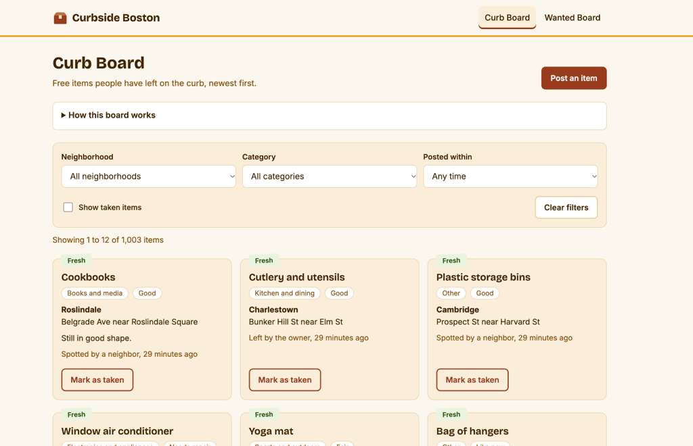

# Curbside Boston

**Find free furniture on the curb before the trash truck does.**

Live site: https://curbside-boston.vercel.app



## Authors

- **Kothuri Venkata Srujan** ([@srujankothuri](https://github.com/srujankothuri)): Curb Board (`curbItems` collection)
- **Lakshmana Kontemukkula** ([@lakshmana2003k-afk](https://github.com/lakshmana2003k-afk)): Wanted Board (`wantedRequests` collection)

## Class

[CS 5610 Web Development (Online), Northeastern University, Fall 2026](https://johnguerra.co/classes/webDevelopment_online_fall_2026/), taught by [John Alexis Guerra Gómez](https://johnguerra.co).

## Project objective

Every move-out season, usable furniture ends up on Boston's curbs and then in the trash, because nobody knows it's there. Marketplaces and Buy Nothing groups need messaging and pickup scheduling, which doesn't fit curb items that anyone can take and that disappear within hours.

Curbside Boston is a free board for exactly that moment, covering Boston's neighborhoods plus Cambridge and Brookline:

- **Curb Board:** post items you left on the curb or spotted on your street. Browse and filter by neighborhood, category, and how recently items were posted. Freshness labels show what's likely still there, and anyone can mark an item as taken once it's gone.
- **Wanted Board:** post requests for things you need, with the neighborhoods you can pick up from, so people clearing out their place can find you.

No account is needed. Each browser gets an anonymous ID, so you can edit and delete your own posts from the browser you posted them from.

## Design document

The design document, with personas, user stories, and annotated wireframes for every page, is in [docs/design-document.md](docs/design-document.md).

## Tech stack

- **Frontend:** HTML5, CSS3, and vanilla JavaScript (ES6 modules), with all data rendered in the browser using the Fetch API
- **Backend:** Node.js and Express, using ES modules only
- **Database:** MongoDB Atlas with the native Node.js driver
- **Deployment:** Vercel

No React, Mongoose, template engines, or server-side rendering.

## Instructions to build

**Requirements:** Node.js 20.6 or newer, and a MongoDB Atlas cluster (the free tier works).

1. Clone the repository and install the dependencies:

   ```
   git clone https://github.com/srujankothuri/curbside-boston.git
   cd curbside-boston
   npm install
   ```

2. Copy `.env.example` to a new file named `.env`, and fill in your own values:

   ```
   MONGODB_URI=your-mongodb-connection-string
   DB_NAME=curbside
   ```

   In Atlas, allow network access from your IP address (or `0.0.0.0/0` for deployment).

3. Seed the database with sample data (over 1,000 records per collection):

   ```
   npm run seed:curb
   npm run seed:wanted
   ```

   The seed scripts only replace data they created, so real posts are never deleted. Seeded dates are spread over the past few weeks, relative to when the script runs, so re-run them to refresh the "Fresh" labels.

4. Start the development server:

   ```
   npm run dev
   ```

   Open http://localhost:3000.

**Other scripts:**

- `npm run lint`: check the code with ESLint
- `npm run format`: format the code with Prettier
- `npm start`: start the server without loading `.env` (used in production)

**Deploying to Vercel:** import the repository, then add `MONGODB_URI` and `DB_NAME` as environment variables in the project settings.

**Health check:** `/api/health` reports whether the server can reach the database, which is useful for checking a deployment.
## Project structure

```
server.js                Express app
backend/db/              MongoDB connector and one module per collection
backend/routes/          API routes for each collection
backend/middleware/      Anonymous ID handling
scripts/                 Seed scripts
public/                  HTML pages, CSS modules, and frontend JavaScript
docs/                    Design document, wireframes, and screenshot
```

## Use of AI

We used Claude (Anthropic) to support our workflow and assist with documentation. All design decisions and implementation were carried out by our team.

## License

[MIT](LICENSE)
