# Curbside Boston: Design Document

**Find free furniture on the curb before the trash truck does.**

Team: Kothuri Venkata Srujan and Lakshmana Kontemukkula
Course: CS 5610 Web Development (Online), Northeastern University, Fall 2026

---

## 1. Project description

Every move-out season, especially around September 1, residents of Boston and nearby Cambridge and Brookline leave usable furniture and household items on the curb. Most of it ends up in the trash, because nobody knows it is there. Free listings on Facebook Marketplace or Buy Nothing groups require messaging and scheduling a pickup, which does not fit curb items: anyone can take them, and they disappear within hours.

Curbside Boston is a web app with two independent parts:

- **Curb Board** (built by Srujan): people post items they have left on the curb or spotted on their street. Others browse and filter by neighborhood, category, and how recently items were posted, and anyone can mark an item as taken once it is gone.
- **Wanted Board** (built by Lakshmana): people post requests for items they need, with their preferred neighborhoods, so people giving things away can find them.

Every post shows how long ago it was made, so users can tell which items are likely still there. No account is needed: each browser gets an anonymous ID, so people can edit and delete their own posts from the browser they posted from.

**Why it matters:** the app keeps usable items out of the trash and helps students and new residents furnish their apartments for free, at the exact moment both groups need it.

**Scope:** the app covers Boston's neighborhoods plus Cambridge and Brookline. Posts never include exact house numbers, only a street or cross street.

---

## 2. User personas

### Ananya, a graduating student

Ananya is finishing her master's degree and moving out of her Mission Hill apartment. She is flying home and cannot take her bookshelf, desk, or kitchen supplies. She hates the idea of good furniture going to a landfill, but she has no time to message strangers and schedule pickups during her last busy week. She wants to put her things on the curb, post them in a minute, and know someone will use them.

### Rohan, a new grad student

Rohan just moved to Boston from India with two suitcases and an empty room in Allston. New furniture is expensive, and he has no car. He has heard that people leave furniture on the curb around September 1, but he doesn't know where to look or whether the items will still be there when he arrives. He wants to see what is available near him, right now.

### Meera, a neighbor

Meera has lived in Brookline for years and often walks past good items left on the sidewalk: a lamp, a set of chairs, a bike rack. She doesn't need them herself, but she hates seeing them go to waste. She wants a quick way to tell others what she has seen, before the trash truck arrives.

---

## 3. User stories

Each story is owned and implemented end to end (database, Express routes, and vanilla JavaScript frontend) by one team member.

### Curb Board (Kothuri Venkata Srujan, `curbItems` collection)

**Story 1: Posting an item I left out**
Ananya is carrying her bookshelf down to the curb on moving day. She opens Curbside Boston on her phone, taps "Post an item," and picks "I left this out." She enters "Wooden bookshelf, 5 shelves," chooses Furniture and Good condition, selects Mission Hill, and types "Tremont St near Huntington Ave." She adds a note that it is heavy and needs two people, then submits. The app takes her to the Curb Board, shows "Your item is posted," and her bookshelf appears at the top, marked as fresh.

**Story 2: Posting an item I spotted**
On her morning walk, Meera passes three dining chairs on a Brookline sidewalk. She stops, opens the app, and posts them, choosing "I spotted this" so others know she is not the owner. Her post appears on the board as "Spotted by a neighbor · just now," so anyone nearby can get there first.

**Story 3: Browsing and filtering**
Rohan needs a desk. He opens the Curb Board and filters by Allston, Furniture, and "Last 24 hours." The board updates immediately and shows only fresh furniture near him, newest first, with a line like "Showing 1 to 12 of 37 items." Each card shows its condition, its street, and how long ago it was posted. He sees a desk posted two hours ago, three blocks away, and heads out.

**Story 4: Marking an item as taken**
When Rohan arrives, the desk is there, and he carries it home. He opens the item on the board and taps "Mark as taken," then confirms. The card updates right away, and the desk disappears from the default view, so nobody else makes the trip. If he had arrived and found it gone, he would do the same.

**Story 5: Editing and deleting my own posts**
After posting, Ananya realizes she picked the wrong condition for her bookshelf. Her post shows a "Your post" label with Edit and Delete buttons that only she can see. She taps Edit, the form opens with her details filled in, and she saves the change. Later, someone mistakenly marks her bookshelf as taken while it is still on the curb, so she switches it back to available. When a friend takes her kitchen supplies before anyone else could, she deletes that post entirely.

### Wanted Board (Lakshmana Kontemukkula, `wantedRequests` collection)

**Story 6: Posting a request**
Rohan still needs a bed frame and can't find one on the Curb Board. He opens the Wanted Board, taps "Post a request," and enters what he needs, the category, and the neighborhoods he can reach without a car. He adds a way to contact him, so people giving things away can let him know.

**Story 7: Browsing and filtering requests**
Before moving out, Ananya checks the Wanted Board to see whether anyone nearby needs what she is leaving behind. She filters by Furniture and Mission Hill and finds a request for a bookshelf. Instead of leaving hers to chance, she contacts the person directly.

**Story 8: Marking a request as found**
A week later, Rohan finds a bed frame. He marks his request as found, so people stop reaching out to offer him one.

**Story 9: Editing and deleting my own requests**
Rohan decides he can also use a desk lamp, so he edits his request to add it. Once he has everything he needs, he deletes his old requests so the board only shows what people still need.

---

## 4. Features

### Curb Board

- Post an item with title, category, condition, neighborhood, street or cross street, optional description, and whether the poster left it out or spotted it.
- Browse items newest first, 12 per page, with pagination.
- Filter by neighborhood, category, and how recently items were posted (any time, last 24 hours, last 3 days, last 7 days). Filters apply immediately and are kept in the page address, so links can be shared and the back button keeps them.
- Freshness labels on every card: "Fresh" for under 24 hours, the age for 1 to 3 days, and "May be gone" for anything older.
- Anyone can mark an item as taken, after a confirmation. Taken items are hidden by default and can be shown with a checkbox.
- The original poster can edit, delete, or switch a taken item back to available.

### Wanted Board

- Post a request with the item needed, category, preferred neighborhoods, details, and a contact.
- Browse and filter requests by category and neighborhood.
- Mark a request as found.
- The original poster can edit or delete their requests.

### Shared

- A home page explaining the app, with "How it works" instructions.
- A "How this board works" section on each board.
- Anonymous posting with no account: each browser gets a random ID that marks its own posts.

---

## 5. Pages and navigation

| Page                   | File                | Owner     |
| ---------------------- | ------------------- | --------- |
| Home                   | `index.html`        | Shared    |
| Curb Board             | `curb-board.html`   | Srujan    |
| Post or edit an item   | `post-item.html`    | Srujan    |
| Wanted Board           | `wanted-board.html` | Lakshmana |
| Post or edit a request | `post-request.html` | Lakshmana |

Every page shares the same header (app name linking home, plus links to both boards) and footer. Each board has its own button to post.

---

## 6. Design mockups

Annotated wireframes for every page, at desktop and phone widths. The numbered markers on each wireframe match the notes beside it, which explain how that part of the page behaves.

### Home

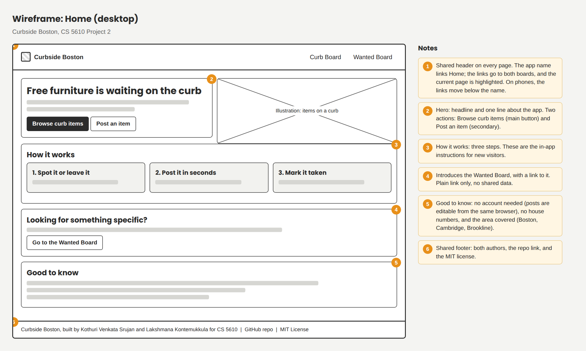
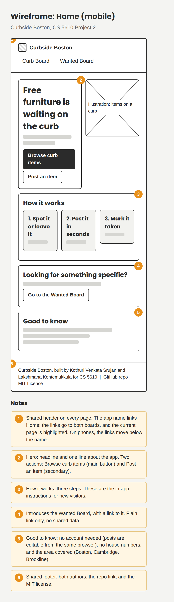

### Curb Board

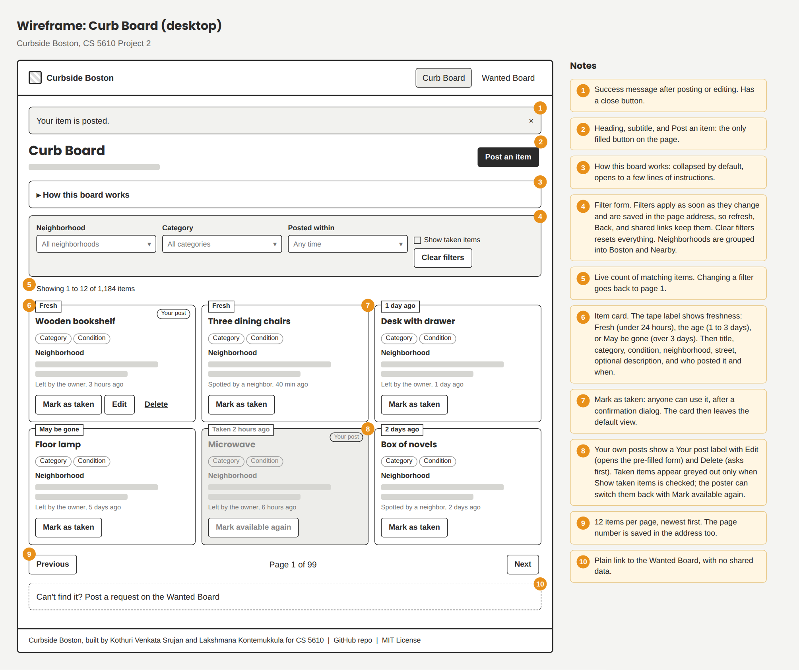
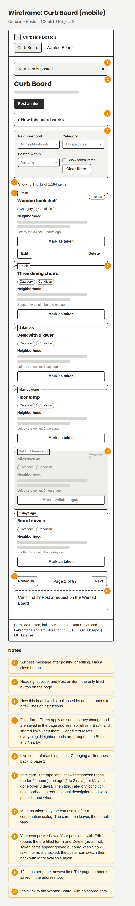

### Post an item

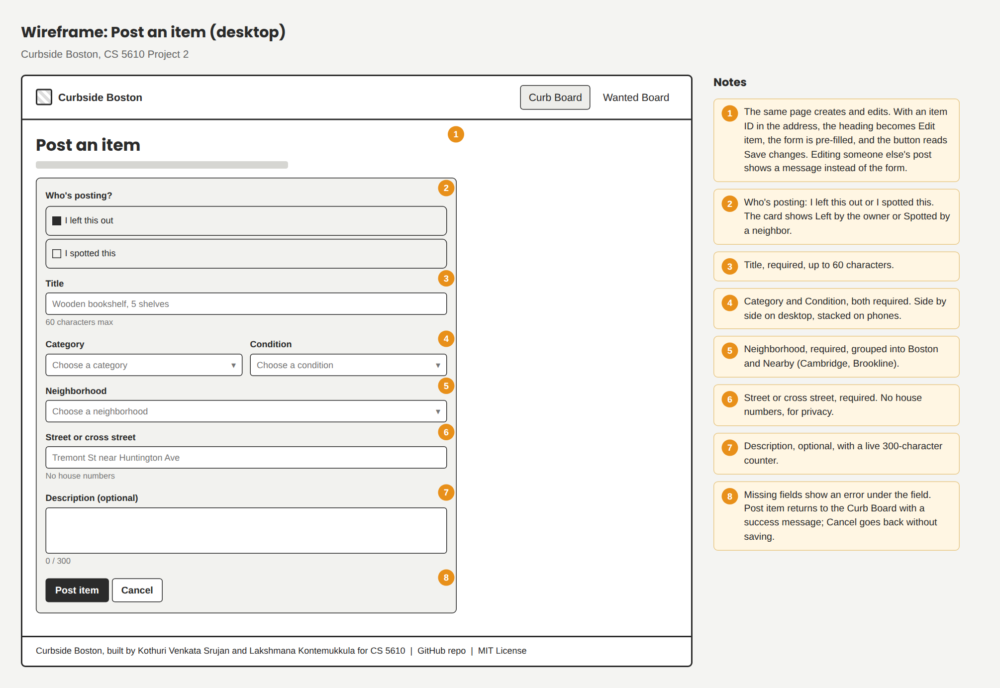
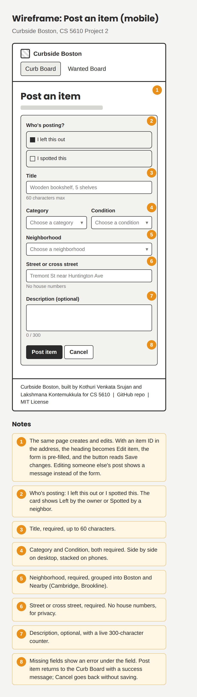

### Wanted Board

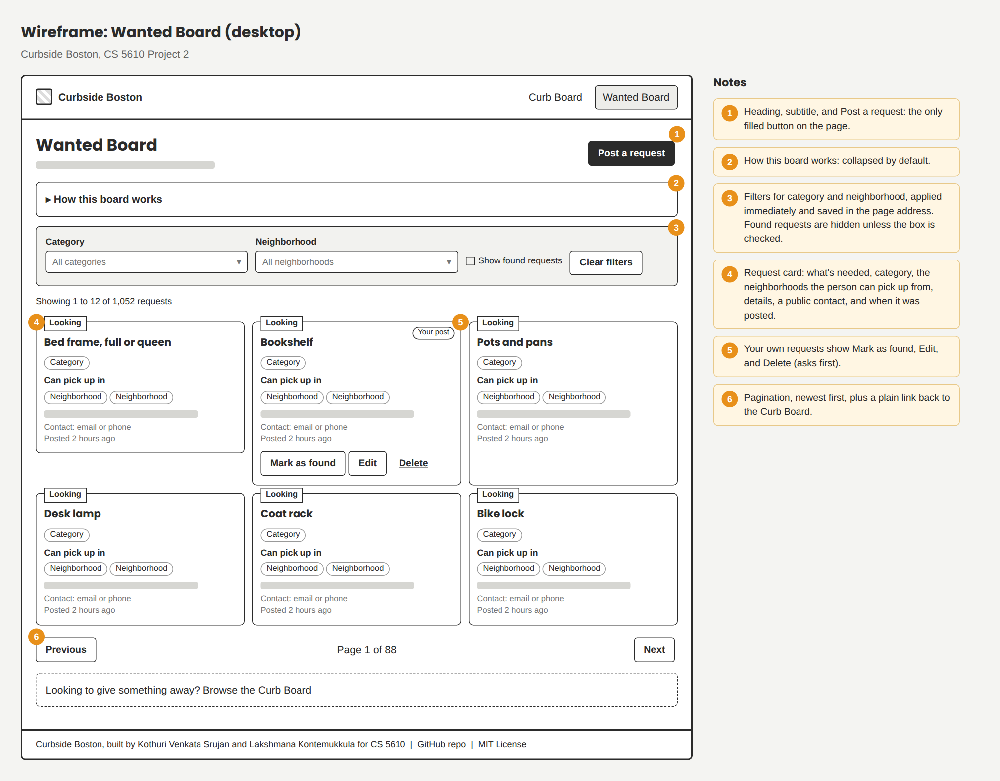
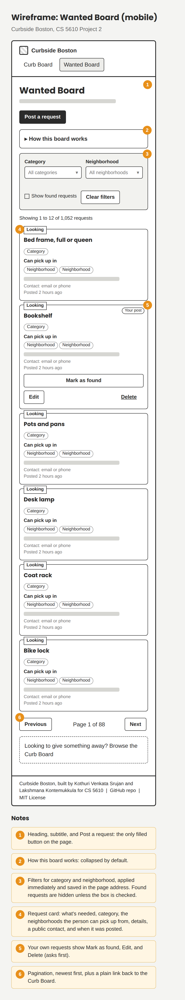

### Post a request

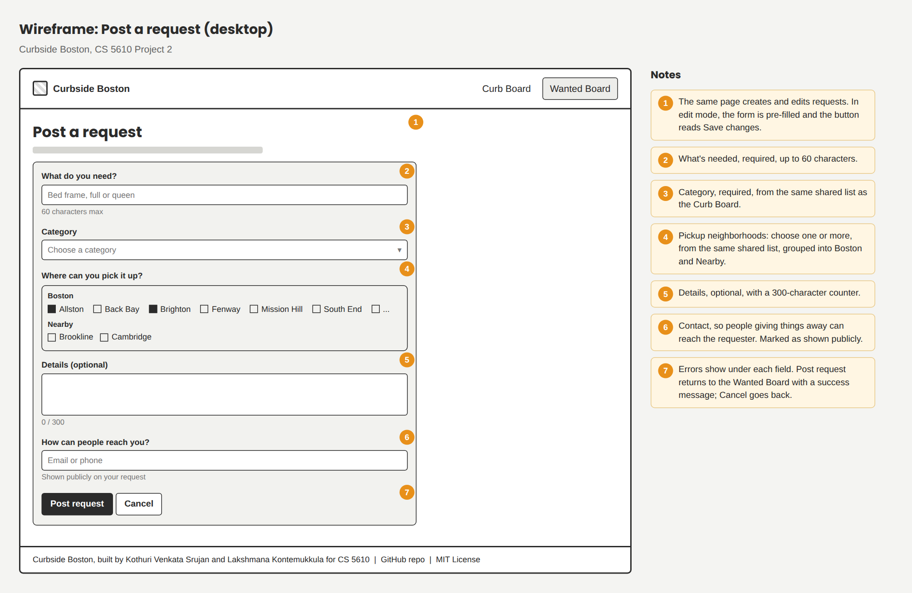
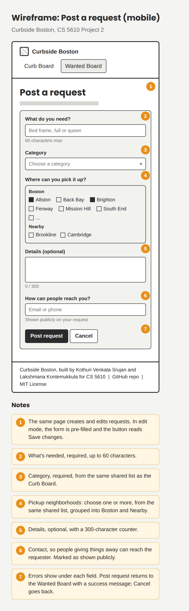

---

## 7. Visual style

The look is inspired by moving day: kraft paper, cardboard boxes, and hand-written signs.

| Role            | Color                                       |
| --------------- | ------------------------------------------- |
| Page background | Cream `#FBF6EE`                             |
| Cards           | Kraft `#FAEEDA` with a tan `#EAD3A8` border |
| Main text       | Dark brown `#412402`                        |
| Secondary text  | Medium brown `#854F0B`                      |
| Primary action  | Terracotta `#993C1D`                        |
| Fresh badge     | Green `#EAF3DE` with `#27500A` text         |
| Danger          | Red `#A32D2D`                               |

Headings use Bricolage Grotesque and body text uses Inter. The layout is mobile-first, since people use the app standing on the sidewalk: one column on phones, two on tablets, and three on desktop.

These style references show how the colors, fonts, and freshness labels come together:

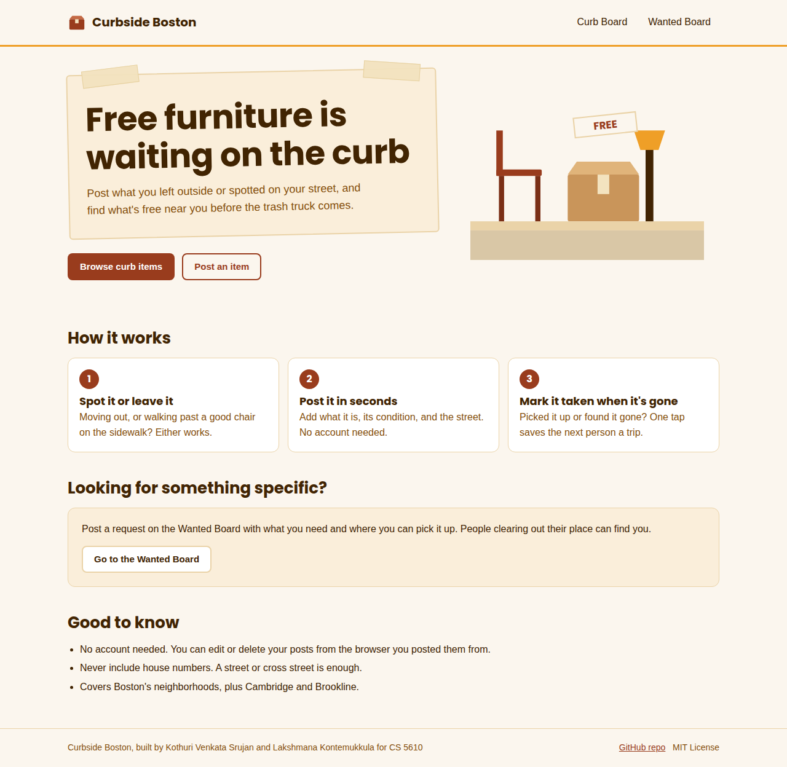
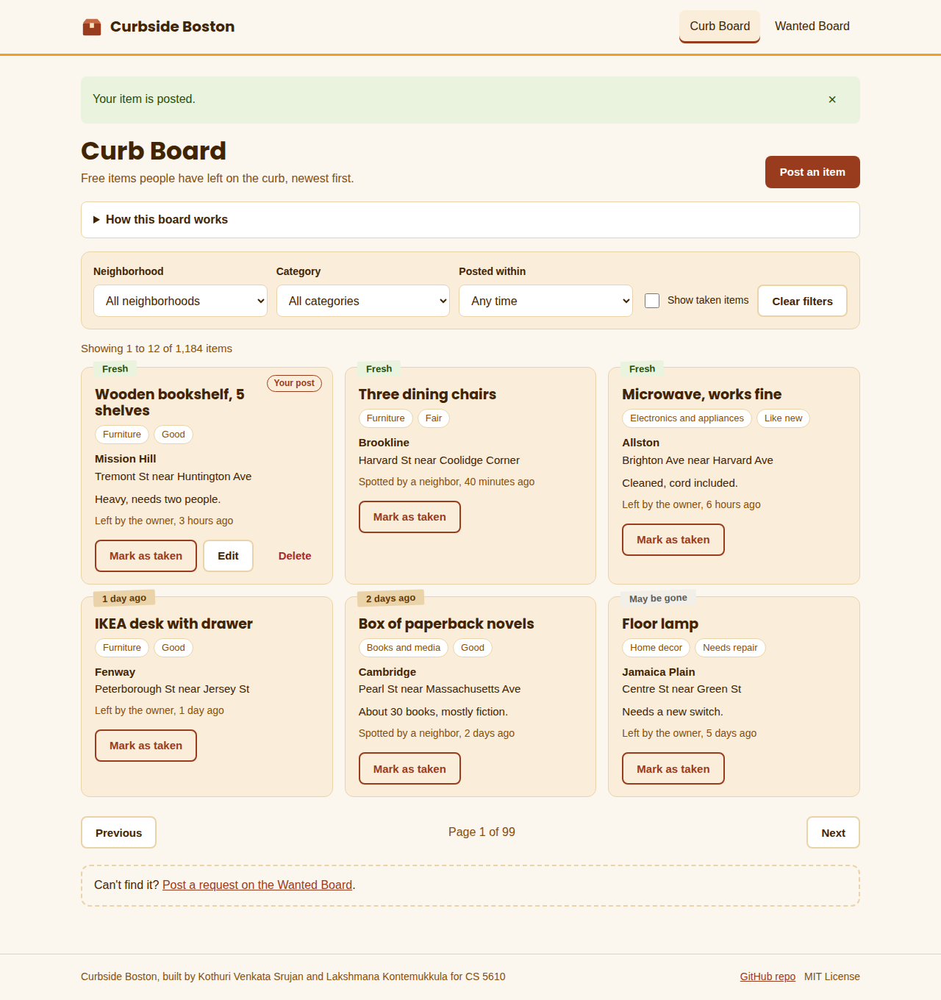

---

## 8. Technical overview

- **Frontend:** HTML5, CSS3, and vanilla JavaScript (ES6 modules), rendering all data in the browser with the Fetch API.
- **Backend:** Node.js and Express, using ES modules only.
- **Database:** MongoDB Atlas with the native Node.js driver, with two collections: `curbItems` and `wantedRequests`. Each is seeded with over 1,000 generated records using real neighborhood names.
- **Deployment:** Vercel.
